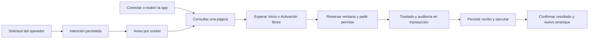

# Revisión de TPVs — 30 de septiembre de 2026

Estado: cambios locales en `avoqado-superadmin`, `avoqado-server` y `avoqado-tpv`, sin publicar.
Producción se inspeccionó en modo lectura. La TPV reportada ya había sido migrada manualmente;
su estado actual no demuestra que el intento original funcionara.

## Primera revisión — 30 de septiembre

- Inventario exclusivo de TPVs. Búsqueda, filtros, conteos y paginación en servidor (25 por página,
  máximo 100); exportación completa sólo a petición y recorriendo páginas. Agrupar conserva búsqueda
  y exportación, y explica que agrupa la página actual.
- Detalle actualizado por ID; carga de ajustes inexistentes termina con un estado de error.
- Los ajustes que la API no reporta aparecen indeterminados, con explicación, en lugar de fingir
  que están apagados. La edición sigue enviando únicamente lo que el operador cambió.
- Rutas canónicas de comandos, ajustes y versiones. Instalar envía `versionCode` numérico.
  El selector excluye versiones retiradas y de escritorio, y agrupa las variantes del mismo código;
  la TPV resuelve la descarga dentro de su propio entorno, como hace el APK existente.
  Exportar logs queda deshabilitado hasta que el aparato lo implemente; SHUTDOWN dice «Cerrar app».
- Historial con identidad real de cada comando, estado, vencimiento y error. Encolar no implica
  ejecutar; SENT tampoco demuestra recepción. Actualización por eventos y acción manual.
  Se agrupan las ráfagas de avisos durante 500 ms: una prueba de 20 eventos produce un solo refresco.
- Migración: valida destino y merchants antes de escribir. Venue, asignaciones, configuración de
  pago copiada y borrado se guardan en una transacción. Si encolar falla, se revierte todo.
  No seleccionar merchant utiliza la configuración compatible del destino; si no existe, bloquea.
- Estados fallido, cancelado y vencido visibles. El contacto posterior de la app no se describe
  como prueba de que el aparato ya puede cobrar. Activación y comandos registran al actor autenticado.

## Límites identificados en la primera revisión

Los puntos de traslado anticipado, vencimiento y carrera de cancelación se corrigieron
en el protocolo nuevo descrito abajo. Se conserva aquí el diagnóstico de la primera ronda.

- La migración todavía cambia el venue del servidor antes de que el aparato ejecute el borrado.
  Esta ronda garantiza atomicidad en la base; **no garantiza que el aparato esté libre de actividad**.
- Los comandos conservan su vencimiento y protocolo anteriores. No se cambió el APK ni se activó
  una cola indefinida. Los SENT antiguos no se deben reenviar: algunos ya destruyeron o reiniciaron
  la app antes de poder confirmar.
- **Instalar una versión aún requiere validar el hardware.** `getSpecificVersion` busca por
  `versionCode + environment`, sin plataforma ni procesador. `AppUpdate` tampoco registra el
  flavor de hardware; los builds PAX y Nexgo tienen SDKs distintos y comparten application ID
  dentro del mismo entorno. Filtrar Android en el selector corrige la lista, pero no garantiza
  que el APK descargado corresponda al aparato. Hace falta guardar y verificar esa compatibilidad
  en publicación, encolado y descarga; no validar por el nombre comercial de la versión.
  Evidencia: `avoqado-server/src/controllers/tpv/appUpdate.tpv.controller.ts:getSpecificVersion`,
  `avoqado-tpv/app/src/main/java/com/jaac/avoqado_tpv/features/self_update/data/AvoqadoUpdateRepository.kt:getSpecificVersion` y
  `avoqado-tpv/app/build.gradle.kts:productFlavors`.
- El indicador de conexión corresponde a la última consulta, cuya hora se muestra. No hay sondeo
  nuevo para recalcularlo continuamente.
- Queda revisar la concordancia entre ajustes heredados del venue, overrides del aparato y valores
  efectivos, además de la carrera entre cancelar una migración y entregar su comando.

## Entrega duradera y ejecución segura — implementada localmente el 1 de octubre

El protocolo 2 mantiene los comandos en la base sin vencimiento. El socket avisa de trabajo; la
app consulta al conectar/reconectar, abrirse o volver a Inicio/Activación libres. No se agregó
un temporizador de comandos. Se recorren páginas de diez únicamente mientras se confirman
resultados; una operación pendiente o un fallo de red detiene ese recorrido hasta otro evento.
Los APKs antiguos conservan su entrega y vencimiento anteriores: no se reenvían borrados legacy.

El punto seguro no depende del PIN: app visible, Inicio/Activación, sin cobro/devolución ni
preparación del SDK, y sin evidencia financiera pendiente. Los diálogos de monto, ajustes y
reinicio de Inicio reservan la ventana mientras están abiertos. Toda otra ruta se considera ocupada.
La app reserva la ejecución antes del permiso del servidor. Descargas/instalaciones solicitadas
vuelven a comprobar esa reserva al aceptar; la activación reinicia dentro de la misma reserva.

La migración del protocolo nuevo guarda una intención. Hasta el permiso de ejecución conserva
el venue y los merchants originales. El permiso revalida destino y comercios, y confirma traslado,
cola y auditoría en una transacción. Puede cancelarse incluso después de entregarse, mientras no
esté ejecutando. No puede descartarse una ejecución incierta. La confirmación requiere un recibo
completado y un nuevo arranque autenticado; consultar el estado público no demuestra un borrado.

Los IDs y recibos se guardan cifrados antes del efecto, sobreviven al cierre de sesión y al borrado
administrativo. Una acción interrumpida no se repite a ciegas: conserva un resultado incierto para
revisión. Los comandos no implementados devuelven rechazo.



La prueba física sigue pendiente por decisión del usuario: PAX/Nexgo dedicadas, backend de
desarrollo y procesador sandbox. Debe cubrir desconexión, respuesta perdida, cierre del proceso,
reapertura, pagos/devoluciones en curso, ledger pendiente y cambio de venue. Medir CPU, memoria
y peticiones en aparato. Las pruebas automáticas no sustituyen esa validación.

## Evidencia local

| Flujo                | Comprobado                                                 | Pendiente                                                |
| -------------------- | ---------------------------------------------------------- | -------------------------------------------------------- |
| Inventario y filtros | UI local, datos reales locales y pruebas automáticas       | Observación de carga después de un despliegue autorizado |
| Migración            | Bloqueo visible sin merchant y rollback real en PostgreSQL | Ejecución en aparato, recuperación y exclusión de cobros |
| Comandos             | Contrato de encolado, validaciones y estados               | Comprobación física de recuperación y consumo en aparato |
| Ajustes              | UI, estados desconocidos y regresiones                     | Concordancia de valores heredados y efectivos en aparato |
| Versiones            | Selector y payload numérico                                | Compatibilidad PAX/Nexgo validada de extremo a extremo   |
| Alta y activación    | Validaciones y actor autenticado del backend               | Activación física con el flujo revisado                  |
| Acceso de personas   | Pantalla del paso previo; se eligió Omitir                 | No se probó un otorgamiento real de permisos             |

- Regresión ejecutable de rollback real: `avoqado-server/tests/manual/tpv-migration-atomicity.ts`.
  Inyecta un error después de crear el comando y su historial; comprueba que no queda un traslado
  parcial y elimina únicamente la terminal ficticia de prueba. Rechaza bases que no sean locales.
- Consulta real del inventario: 6 TPVs de 30 dispositivos locales, sin mezclar otros tipos.
- Ensayo SQL con 13,300 filas sintéticas en tabla temporal: página de 25 en ~4.5 ms y conteo en
  ~1.9 ms en esta Mac. Se revirtió la transacción; no es una medición de carga de producción.
- Verificación completada: superadmin `npm run check` (lint, tipos y 1,109 pruebas); backend
  `npm run typecheck` (incluye pruebas y scripts) y módulo de terminales (24 suites, 305 pruebas
  en la Mac). Los últimos ajustes de filtrado de versiones se comprobaron además con las pruebas
  puntuales de API y drawer. El build de superadmin pasó en ambas máquinas (COINCIDEN), usando
  los mismos valores públicos de prueba para API y cliente OAuth.
  Publicar primero backend y su migración de índices, después UI; esta ronda aún no es publicable.
- Navegador contra localhost: lista, búsqueda, agrupación, detalle, historial vacío, selector de
  versiones, ajustes y vista móvil. Tras recuperarse el backend compartido, la validación previa
  bloqueó correctamente el destino «Avoqado Empty» sin merchant seleccionado: mostró que carece
  de configuración de pagos y no ofreció ejecutar. No se otorgaron accesos, no se ejecutó una
  migración ni se enviaron comandos reales. Consola sin errores en esta comprobación.

## Resultado de la regresión unitaria general del backend

La corrida incluyó el build y las cuatro partes de la suite unitaria: 21,160 pruebas por máquina, con
14 omitidas por la suite existente. Mac: 21,144 aprobadas y 2 fallidas. Alienware: 21,145 aprobadas
y 1 fallida. El build no emitió errores de TypeScript, pero el veredicto compuesto fue
**DIFIEREN; no se considera una validación global verde**.

- El fallo común era el inventario de consultas sin límite: la migración pasó de tres a dos y la
  guardia aún esperaba tres. Se redujo esa excepción; las cuatro pruebas de la guardia pasaron al
  repetirlas. No se relajó la protección.
- Sólo en Mac falló `catalogWorkbook.eventloop-budget.test.ts`: máximo medido 133.739 ms frente al
  límite de 50 ms. Sus cuatro pruebas pasaron aisladas después. El código y el límite de ese módulo
  no se modificaron; esto no demuestra por sí solo la causa de la diferencia bajo la suite completa.
- También difirió la salida del parche idempotente de Prisma (`aplicado` / `ya-aplicado`) y la consola
  de la prueba de órdenes. La repetición acotada incluye esa prueba para no ignorar esa diferencia.

Evidencia de la corrida: `~/.claude/avq-verify/run-avoqado-server.dLSIdw/` (la herramienta puede
limpiarla posteriormente; los totales anteriores quedan registrados aquí).

La repetición acotada con fila única concluyó **COINCIDEN: 3 suites y 33 pruebas aprobadas en
cada máquina**, después de corregir el conteo. Evidencia:
`~/.claude/avq-verify/run-avoqado-server.ndWCtt/`. Esto comprueba los casos implicados; no convierte
retroactivamente la corrida completa divergente en una corrida verde. Se preserva el presupuesto
de 50 ms y no se ignoran fallos para igualar resultados. Comando reproducible desde el workspace:

```bash
AVQ_KEEP=1 AVQ_FILA_UNICA=1 ./scripts/avq-verify.sh avoqado-server npx jest --selectProjects=unit --runTestsByPath tests/unit/architecture/findManySinTopeGuard.test.ts tests/unit/services/master-catalog/catalogWorkbook.eventloop-budget.test.ts tests/unit/services/dashboard/order.dashboard.service.test.ts --runInBand --ci
```

## Retest integral terminado — 1 de octubre

- Superadmin: lint, tipos, 134 suites / 1,114 pruebas y build aprobados.
- Backend: tipos, build y lint aprobados; suite completa en Mac con 1,699 suites y
  21,241 pruebas aprobadas, una suite y 14 pruebas omitidas por la suite existente.
- TPV: 198 suites, 2,609 pruebas aprobadas y ocho omitidas; APK sandbox PAX,
  compilación Nexgo y lint aprobados en Mac.
- UI real del clon: búsqueda, migración sin seleccionar merchant a destino con
  configuración compatible, Pendiente y cancelación. DB, auditoría y logs confirmaron
  que el origen permaneció intacto durante la espera y tras cancelar; vencimiento nulo.
  El acceso de personas se omitió. Consola sin errores ni warnings.
- Flota HTTP: 56 TPVs ficticias en tres páginas con IDs exactos, total visible y cap 100,
  sin impresoras. La UI mostró 62 incluyendo seis TPVs preexistentes del clon.
- PostgreSQL real: rollback tras insertar comando/historial, idempotencia y migraciones
  concurrentes, cancelación tras entrega, permiso y confirmación autenticados.

Reporte local: `/tmp/tpv-retest-QzaRFQ/report.md`, **WARN** por QA física diferida
por el usuario y socket multinstancia sin comprobar (Redis no disponible en el test).
Clon eliminado con PSQL, procesos/pestaña propios cerrados y base original sin fixtures
del run. No hubo cambios en producción ni publicación. Los resultados fallidos históricos
se conservaron como evidencia; las últimas corridas completas están en verde.
